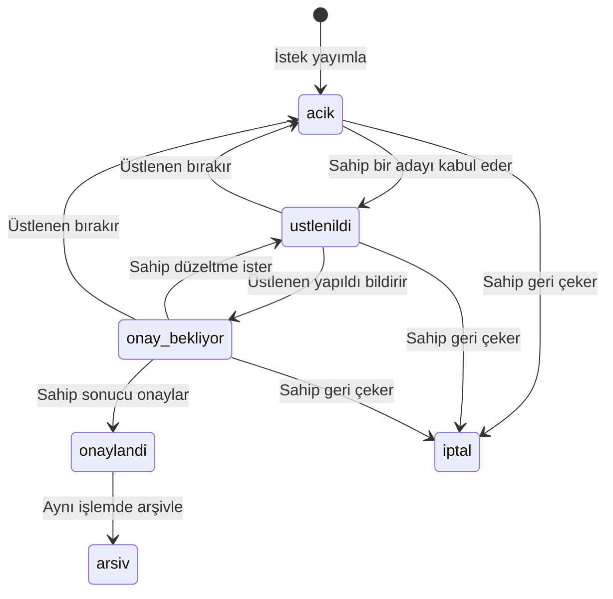

# Görev ve Talep akışları

## İstek ve adaylık

Görevde kaptan/danışman takım ihtiyacını açar; üye veya kaptan aday olur; **açan kişi kabul etmeden üstlenme başlamaz**. Talepte herhangi bir aktif kişi yardım ihtiyacını açar; başka biri teklif eder; talep sahibi kabul eder. Kendi isteğine aday olunamaz. İki türde de tek aktif üstlenen vardır.

Adaylık, isteğin durumundan ayrıdır: `bekliyor`, `kabul`, `seçilmedi`, `geri_çekildi`. Aynı kişinin bir istek için tek adaylık satırı olur; istek yeniden açılınca kişi yeni kısa notla tekrar aday olur. Eski hareketler olay kaydında korunur. Birden çok aday olması isteği açık durumdan çıkarmaz.

`onaylandi` kabul olayını temsil eder, bekleyen ayrı bir veritabanı durumu değildir. İşlem sonunda durum `arsiv` olur ve `onaylandi` olayı yazılır. `iptal` kayıtları arşiv ekranında ayrı filtrede görünür; tamamlanmış sayılmaz. Saklanan durumlar: `acik`, `ustlenildi`, `onay_bekliyor`, `arsiv`, `iptal`.

## Geçiş sözleşmesi

| İşlem | Ön koşul ve yetki | Sonuç / görünür geri bildirim |
|---|---|---|
| Yayınla | Tür yetkisi; başlık ve açıklama; görevde takım amacı/son tarih | Açık; açılış olayı |
| Aday ol | Açık, aktif hesap, sahibi değil | Bekleyen adaylık; pano durumu değişmez |
| Adaylıktan vazgeç | Kendi bekleyen adaylığı | Geri çekildi; istek açık kalır |
| Kabul et | Sahip; açık; bekleyen aktif aday | Üstlenildi; seçilen kabul, diğer bekleyenler seçilmedi |
| Yapıldı | Üstlenen; üstlenildi; sonuç notu | Onay bekliyor; 12/48 saat sayacı başlar |
| Düzeltme iste | Sahip; onay bekliyor; açıklama zorunlu | Üstlenildi; üstlenen korunur, sayaç sıfırlanır |
| Onayla | Sahip; onay bekliyor | Arşiv; tek onay olayı, türe göre bir tamamlanma sayılır |
| Bırak | Üstlenen; üstlenildi/onay bekliyor; neden zorunlu | Açık; üstlenen/sayaç temizlenir, eski adaylıklar tekrar canlanmaz |
| Geri çek | Sahip; aktif üç durumdan biri; neden zorunlu | İptal; adaylıklar kapanır; onay/katkı sayılmaz |
| Danışman kararı | Uyuşmazlık veya 48 saat aşımı; açıklama zorunlu | Onay, düzeltme, yeniden açma veya iptal; ilgili geçişin aynı kuralları |

Sahip isteği yalnız açıkken düzenler; tür sonradan değiştirilmez. Yeniden açılmış istek düzenlenebilir, önceki adaylar yeniden başvurmalıdır. Arşiv ve iptal terminaldir; aynı ihtiyaç tekrar doğarsa yeni istek açılır. Yayımlanmış yorum ve olaylar sonradan değiştirilemez. Yanlış yorum için yeni düzeltme yorumu eklenir.

## Belgedeki beş sorunun cevabı

1. **İki kişi aynı göreve talip olursa:** ikisinin adaylığı da görünür. Açan kişi gerekçeli seçim yapar; erken tıklamak öncelik hakkı değildir. Aynı anda iki kabul gelirse veritabanındaki tek işlem açık durum ve kayıt sürümünü kontrol eder; biri kazanır, diğeri “Bu istek güncellendi, yenileyin” görür. Üstlenen asla iki kişi olmaz.
2. **Üstlenen yapamazsa:** detayda “Bırak” seçer, kısa neden ve varsa yarım kalan işin nerede kaldığını yazar, sonra onaylar. Bu not takımın görebildiği hareket kaydında kalır. Üstlenen temizlenir, istek tekrar açık olur. Eski adaylar otomatik atanmaz; yeniden başvurabilir. Bırakmak puan/ceza üretmez.
3. **Yapıldı hiç onaylanmazsa:** Batu'nun 2026-10-09 kararı: yapıldı olayından 12 saat sonra sahip için detayda hatırlatma; 48 saat sonra danışman özeti kuyruğuna ekleme. Süre takvim saatiyle, UTC farkıyla ölçülür; hafta sonu durmaz. Otomatik başarı/onay yoktur. Danışman tarafların ortak yorumlarını inceleyerek gerekçeli karar verir. Eşikler sayfa açıldığında veya yenilendiğinde olay zamanından hesaplanır; eşik geçince ilgili hatırlatma/kuyruk görünür. Pilot için danışmanın kuyruğu günde bir kez kontrol etmesi önerilir; 48 saat incelemeye açılma eşiğidir, kararın aynı anda verileceği garantisi değildir. Hakem de üstlenen ise otomatik çözüm yok; sahip onayı gerekir.
4. **Son tarih:** görevde zorunlu, talepte isteğe bağlı. Geçmiş tarihli yeni istek açılamaz. Tarih, İstanbul saatine göre gün sonudur. Süre geçince “Gecikti” etiketi ve danışman kuyruğu oluşur; görev iptal edilmez. Açık isteğin sahibi gerekçeyle tarihi değiştirebilir; üstlenilmiş işte değişiklik için danışman uyuşmazlık kararını kullanır.
5. **Açan geri çekebilir mi:** arşivlenmeden önce evet, neden yazar; üstlenen varsa form yapılan emeğin kayıtta kalacağını açıklar. Üstlenen buna ortak yorumla itiraz edebilir ve danışmana bildirebilir. İptal sonucu onaylanmış iş toplamına girmez. İptalin amacı işi kapatmaktır; işi görünmez silmek değildir.

## Hiyerarşi kalkanı

Görev formu “Takım için beklenen çıktı nedir?” açıklamasını zorunlu ister. Kişisel ihtiyaç bildiren kişi Talep sekmesine yönlendirilir. Sözcük kontrolü kişisel amaç tespitinde kesin karar vermez. Yanlış yayımlanmış görev için herkes gerekçeli bildirim oluşturabilir. Bildirimin kimin tarafından yapıldığı ve gerekçesi danışman tarafından görülür; bu, özel sohbet değil tek işlem kaydıdır. Danışman ortak alanda karar gerekçesini yazar; uygunsuz görev iptal edilir. Sahip isterse yeni bir talep açar. Tür değiştirilerek önceki görev izi silinmez.

## Yarışlar ve hatalar

Kabul, bırakma, yapıldı, onay ve iptal; durum/sürüm kontrolü ve olay yazımıyla tek veritabanı işlemidir. Çift tıklama ikinci kez olay veya sayım üretmez. Eşzamanlı iptal/onayda ilk geçerli işlem tamamlanır, ikincisi çakışma görür. İnternet kopunca buton sonuç gelene kadar kilitlenir; tekrar gönderimde eski sürüm ve güncel durum kontrol edilir. Sayfa yenilenip son durum görülmeden başarı gösterilmez. 403 yetkisiz, 409 güncel olmayan işlem, alan hatası ilgili form alanında Türkçe görünür.

İstek listesi: aktifler önce; son tarih artan, son tarihsizler en sonda; eşitlikte oluşturma zamanı artan ve kimlik artan. Arşiv: onay olayı tarihi azalan. Sayaçlar istek adedidir, aday/yorum adedi değildir.
